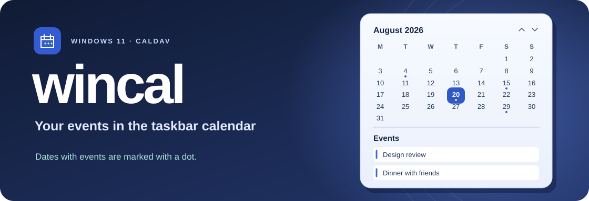

<div align="center">
  

  <h1>wincal</h1>
  <p>See your CalDAV events in the Windows 11 taskbar calendar.</p>

  <a href="https://github.com/Eng-ReQTeCH/Wincal/releases/latest"></a>
  <a href="https://github.com/Eng-ReQTeCH/Wincal/actions/workflows/build.yml"></a>
  <a href="LICENSE"></a>
  <a href="https://ko-fi.com/engmonzy"></a>

  <p>
    <a href="#download">Download</a> ·
    <a href="#setup">Setup</a> ·
    <a href="#build-from-source">Build</a> ·
    <a href="CHANGELOG.md">Changelog</a> ·
    <a href="#support-wincal">Support</a>
  </p>
</div>

## Download

| Windows 11 PC | Installer |
| --- | --- |
| Intel or AMD (x64) | [Download x64 setup](https://github.com/Eng-ReQTeCH/Wincal/releases/latest/download/wincal-setup-x64.exe) |
| ARM64 | [Download ARM64 setup](https://github.com/Eng-ReQTeCH/Wincal/releases/latest/download/wincal-setup-arm64.exe) |

The installers are unsigned. See the [latest release](https://github.com/Eng-ReQTeCH/Wincal/releases/latest) for SHA-256 checksums and release notes.

**New in 0.4.5:** fixes the recurring “invalid event date or duration” refresh error caused by zero-length timed events. See the [changelog](CHANGELOG.md) for details.

## Features

- **Built into the calendar flyout.** Open the taskbar clock or press **Win+N**. Dots mark days with events, and selecting a date shows its event titles.
- **Instant access to cached dates.** The encrypted cache covers the past 90 days and the next 180 days. Saved events remain available offline.
- **Background refresh.** wincal checks for updates at sign-in, when the flyout opens, and once a minute while it remains open. Browsing outside the cache window fetches more dates.

## Setup

1. Enter the full CalDAV calendar collection URL and any required login.
2. Select **Test connection**, then **Install**. Use **Try with a sample event** to try wincal without a server.
3. Open the Windows taskbar calendar, expand the date grid, and select a date. Scroll over the event list to view a long agenda.

Choose **Keep settings** to upgrade from an earlier version, including Win11CalendarFix. Your saved connection and event cache carry over. **Flyout status** in setup shows the launcher and calendar integration status.

## Compatibility and privacy

**CalDAV.** wincal reads one calendar over HTTP or HTTPS with anonymous access or HTTP Basic authentication. It needs a direct collection URL and a server that supports calendar-query reports and recurrence expansion. OAuth, automatic discovery, redirects, and event editing are unsupported.

**Privacy.** Windows encrypts saved credentials and cached events for the current user. Use HTTPS to protect credentials and event data in transit.

**Windows.** The integration depends on the internal Notification Center layout. It was verified with Radicale on Windows 11 25H2 x64 (build 26200.9974). The ARM64 installer contains native ARM64 binaries. Live ARM64 validation is pending.

## Uninstall

Go to **Settings → Apps → Installed apps → wincal → Uninstall**. If Windows is still using the calendar DLL, sign out and back in to finish removing it.

## Build from source

Install Visual Studio 2022 Build Tools or newer with **Desktop development with C++** and the **Windows 11 SDK**. For the ARM64 cross-build, also select **MSVC C++ ARM64 build tools** in Visual Studio Installer. The installer UI uses the .NET Framework compiler included with Windows.

From the repository root, run the commands for the architectures you need.

```powershell
.\build.cmd x64
.\build.cmd arm64
```

Setup executables go to `build\wincal-setup-x64.exe` and `build\wincal-setup-arm64.exe`. The x64 build runs the parser, cache, attachment ownership, and installer smoke tests. To run the remaining checks on x64, use the following commands.

```powershell
.\build\x64\installer_test.exe --registry
.\build\x64\installer_test.exe --http
.\build\x64\flyout_test.exe
```

The registry test uses a temporary per-user key and covers upgrades with a locked previous DLL. The HTTP test uses a temporary loopback CalDAV server. The native flyout test requires a Windows desktop with the system XAML runtime; it hosts the production panel in a disposable hidden window and checks selection, concurrent publication, cleanup, and reattachment without changing the installed app or the shell. [GitHub Actions](.github/workflows/build.yml) builds both installers and runs the x64 build tests plus registry and HTTP checks.

## Source layout

| Path | Responsibility |
| --- | --- |
| [`src/calendar.cpp`](src/calendar.cpp) | CalDAV requests, iCalendar parsing, and event dates |
| [`src/cache.cpp`](src/cache.cpp) and [`src/agenda.h`](src/agenda.h) | Encrypted disk cache and the shared agenda format |
| [`src/launcher.cpp`](src/launcher.cpp) | Background refresh and connection to the Windows flyout |
| [`src/flyout.cpp`](src/flyout.cpp) | Event titles and date dots in the native calendar |
| [`installer/Setup.cs`](installer/Setup.cs) and [`installer/SetupForm.cs`](installer/SetupForm.cs) | Per-user installation, settings, and setup UI |
| [`tests/`](tests/) | Calendar, cache, installer, and loopback tests |

## Support wincal

If wincal helps you, consider [making a donation on Ko-fi](https://ko-fi.com/engmonzy). Donations help cover development and testing.

<a href="https://ko-fi.com/engmonzy"></a>

Licensed under the [MIT License](LICENSE). Found a problem? [Open an issue](https://github.com/Eng-ReQTeCH/Wincal/issues).
